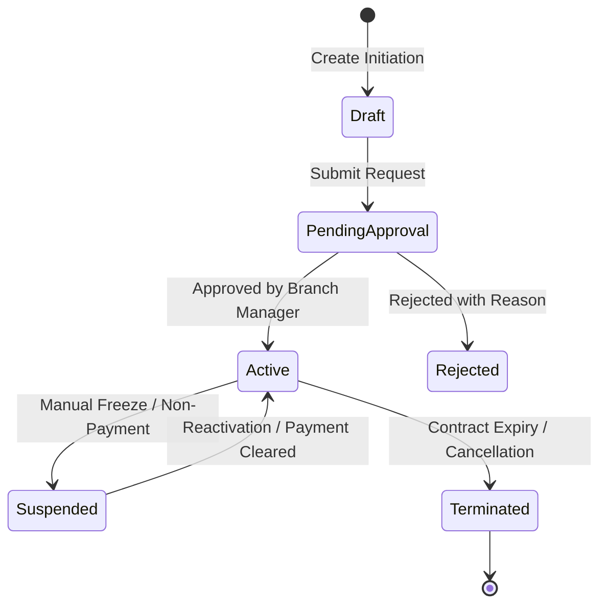

# Feature Specification Document (BCAS Modular Spec)

| Metadata Attribute | Value |
| :--- | :--- |
| **Feature ID** | `[FEATURE-XXX]` |
| **Feature Name** | `[Feature Name]` |
| **Project Context Ref** | `docs/business-context/PROJECT_CONTEXT.md` |
| **Sprint / Release** | `[Sprint-XX / Batch-X]` |
| **Target Platforms** | `Web Admin`, `Member Portal`, `Mobile` |
| **Risk Profile** | `STANDARD` _(Options: LIGHT \| STANDARD \| CRITICAL)_ |
| **Readiness Status** | `READY_FOR_DEV` _(Options: NOT_READY_FOR_DEV \| READY_FOR_DEV \| IMPLEMENTED)_ |

---

> ### ⚡ EXECUTION CONTRACT DIRECTIVE
> 1. **Authoritative Specification:** This document is the primary source of truth for all functional scope, UI lifecycle states, and acceptance criteria.
> 2. **Zero Guesswork Policy:** Engineers and AI agents MUST NOT invent unstated business rules, fallback behaviors, or shadow database models.
> 3. **Ownership Routing (Section 9):**
>    - `BA_OWNED`: Clarifications must follow the 5-Tier Self-Resolution Ladder before querying human BA.
>    - `BACKEND_OWNED`: Architecture, indexing, transaction boundaries, and DB schema are decided by Senior Backend Architect.
>    - `DESIGN_OWNED`: Visual tokens, responsive typography, and micro-interactions are decided by Senior Frontend Architect.
> 4. **Hard Blocker Gate:** If any item in Section 9.2 is `Open`, code generation is BLOCKED.

---

## 1. Business Context & Related Flows
- **Business Goal:** `[Concise statement of business value and operational objective.]`
- **User Personas:** `[Member, Receptionist, Branch Manager, Finance Officer]`
- **Upstream Flows:** `[Prerequisite flows, e.g. Active Member Registration, Facility Scaffolding]`
- **Downstream Flows:** `[Follow-up flows, e.g. Access Gate Pass Issuance, ZATCA Invoicing]`

---

## 2. Feature Scope Boundaries

### 2.1 In Scope
- `[Explicit functional capability 1]`
- `[Explicit functional capability 2]`
- `[Bilingual localized validation messages and UI state transitions]`

### 2.2 Out of Scope
- `[Deliberately excluded capability 1]`
- `[Capabilities handled by another module or deferred to next sprint]`

---

## 3. Applicable Business Rules

### 3.1 Inherited Global Rules (from `PROJECT_CONTEXT.md`)
- `BR-GLB-001` (Identity Uniqueness)
- `BR-GLB-002` (Dual Localization AR/EN)
- `BR-GLB-003` (Financial Immutability)
- `BR-GLB-004` (Soft Delete & Audit Logging)

### 3.2 Feature-Specific Business Rules (BR-FEAT)

| Rule ID | Rule Title | Business Logic Statement | Error Code / Fallback |
| :--- | :--- | :--- | :--- |
| `BR-FEAT-001` | `[Rule Title 1]` | `[Exact conditional logic, thresholds, or eligibility check.]` | `ERR_RULE_001` |
| `BR-FEAT-002` | `[Rule Title 2]` | `[Exact operational restriction or state transition rule.]` | `ERR_RULE_002` |

---

## 4. Functional Requirements (FR)

| Req ID | Title | Description & Behavior | Traces to Rule |
| :--- | :--- | :--- | :--- |
| `FR-01` | `[Action 1]` | System shall allow `[User]` to `[Perform action]`, verifying `[Conditions]`. | `BR-FEAT-001` |
| `FR-02` | `[Action 2]` | Upon completion of `[Action 1]`, system shall execute `[Follow-up transition]`. | `BR-FEAT-002` |

---

## 5. Data, Validation & Critical Copy

### 5.1 Field Definitions & Constraints

| Field Name | Type | Required | Constraints / Validation | Reused Master Table |
| :--- | :--- | :--- | :--- | :--- |
| `id` | `UUID / BigInt` | Yes | Primary Key | Local |
| `member_id` | `UUID` | Yes | Scalar FK referencing `members.id` | `members` (Master) |
| `status` | `String` | Yes | Enum: `DRAFT`, `ACTIVE`, `SUSPENDED`, `CANCELLED` | Local |

### 5.2 Bilingual AR/EN Critical Copy (Zero Placeholder Texts)

| Copy Key | Arabic Text (Primary) | English Text | Context / Usage |
| :--- | :--- | :--- | :--- |
| `confirm_title` | تأكيد العملية | Confirm Action | Modal Header |
| `success_message` | تم تنفيذ العملية بنجاح | Action completed successfully | Toast Banner |
| `err_not_eligible` | العضو غير مؤهل للاشتراك في هذه الخدمة | Member is not eligible for this service | Form Validation Error |

---

## 6. User Flow, UI States & Lifecycle Transitions

### 6.1 Standard UI States
- **Loading State:** Skeleton loader matching component layout (zero raw spinners).
- **Empty State:** Bilingual prompt with action button to initiate first item.
- **Error State:** Actionable error dialog with retry action and support error code.

---

## 7. High-Risk Scenarios, Interruptions & Edge Cases

| Scenario ID | Scenario Category | Trigger Condition | System Defense & Remediation Behavior |
| :--- | :--- | :--- | :--- |
| `SCN-01` | **Duplicate Action** | Rapid double-click on submit / payment button. | Frontend button debouncing + Backend unique idempotency key (`Idempotency-Key` header). |
| `SCN-02` | **Timeout / Uncertain Outcome** | Network drops after gateway charge but before webhook. | Two-phase transaction verification + Webhook reconciliation job. |
| `SCN-03` | **Offline / Kill / Resume** | Mobile app terminated during multi-step registration. | Local state persistence (AsyncStorage/EncryptedSharedPreferences) with resume prompt. |
| `SCN-04` | **Concurrency Collision** | Two receptionists assign the last available slot simultaneously. | Pessimistic row locking (`SELECT ... FOR UPDATE`) inside atomic DB transaction. |
| `SCN-05` | **Cancel / Abandon** | User abandons checkout flow at payment gateway screen. | Release reserved hold after 15-minute TTL without marking transaction failed. |
| `SCN-06` | **Auth Revoked Mid-Flow** | Staff permission revoked while form was open. | Fail-closed API 403 Forbidden with localized session expiration alert. |

---

## 8. Acceptance Criteria & Bidirectional Traceability Matrix

| AC ID | Given | When | Then | Traces To (FR / BR / SCN) | Provenance |
| :--- | :--- | :--- | :--- | :--- | :--- |
| `AC-01` | Eligible member record | Submits subscription form with valid data | Status set to `ACTIVE`, confirmation returned | `FR-01`, `BR-FEAT-001` | BRD Sec 4.1 |
| `AC-02` | Inactive/expired member | Attempts to enroll | Validation fails with localized `err_not_eligible` | `FR-01`, `BR-FEAT-002` | BRD Sec 4.2 |
| `AC-03` | Concurrent booking attempt | Two clients request last slot | First commits successfully; second receives `SLOT_UNAVAILABLE` | `FR-02`, `SCN-04` | Engineering QA |

---

## 9. Ownership Routing & Decision Handoff

### 9.1 Non-BA Technical Ownership Notes
- **`BACKEND_OWNED`:** Indexing strategy on `(member_id, status)`, transaction boundaries, Redis cache invalidation on status change.
- **`SHARED_MOBILE`:** Offline cache retention window set to 24 hours.
- **`DESIGN_OWNED`:** Status tag color tokens: `ACTIVE` (`emerald-500`), `SUSPENDED` (`amber-500`), `TERMINATED` (`rose-500`).

### 9.2 Open Business Decisions

| Decision ID | Open Business Question | Impact / Scope Blocked | Status | Owner |
| :--- | :--- | :--- | :--- | :--- |
| `DEC-01` | Can a suspended member enter facilities as a guest? | Gate access validation rule | `Resolved (No)` | Product Lead |
| `DEC-02` | Automatic renewal penalty charge policy. | Invoicing & Billing module | `Resolved (None)` | Finance Lead |

### 9.3 Key Business Decisions Snapshot (D-01 .. D-0X)
- `D-01`: Explicit confirmation required before membership status change.
- `D-02`: Cancellation requires written reason categorized under predefined taxonomy.

---

## 10. Pre-Implementation Hard Gate Checklist
- [ ] All `BR-FEAT` rules trace 1:1 to functional requirements.
- [ ] Section 5.2 contains complete Arabic and English translation copy.
- [ ] Section 7 contains robust handling for all 6 critical edge-case scenarios.
- [ ] All Acceptance Criteria (`AC-01..AC-XX`) have automated Pest/Vitest test mappings planned.
- [ ] Section 9.2 has ZERO blocking `Open` business decisions.

---

## 11. Approval & Post-Implementation Deviations Log

| Date | Reviewer Role | Decision | Notes / Approved Deviations |
| :--- | :--- | :--- | :--- |
| `[YYYY-MM-DD]` | Lead Business Analyst | `APPROVED` | Baseline ready for engineering execution. |
| `[YYYY-MM-DD]` | Principal Systems Architect | `APPROVED` | Decoupling and master entity reuse verified. |
