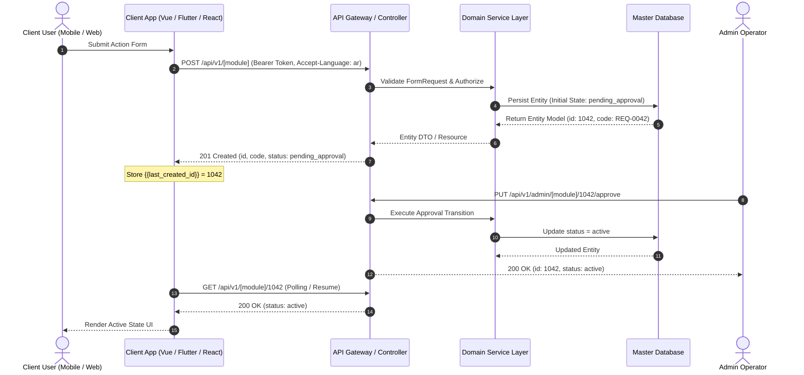

# [Module Name] Integration & Handoff Guide

> **MODULE:** `[ModuleName]`  
> **DOCUMENT VERSION:** `1.0.0` (v3.5.1 Universal Handoff Standard)  
> **ACTIVE BACKEND STACK:** `[Laravel | CakePHP | PHP Native | .NET | Node]`  
> **TARGET CLIENTS:** `[Mobile iOS / Android / Flutter, Web Frontend (Vue 3 / Nuxt 3 / React / Angular / Blade / CakePHP / PHP Native)]`  
> **TARGET TEAMS:** `[Mobile Engineers, Web Frontend Engineers, QA Automation Engineers]`  
> **POSTMAN COLLECTION:** `docs/postman/[module].postman_collection.json`  

---

## 1. Global API Standards & Envelopes

### 1.1 Standard Request Headers
All API consumers (Mobile & Web) MUST provide these standard headers on every call:

| Header | Type | Required | Values / Example | Description |
| :--- | :--- | :--- | :--- | :--- |
| `Accept` | String | Yes | `application/json` | Enforces JSON response envelope |
| `Accept-Language` | String | Yes | `ar` or `en` | Directs backend localization engine (Default: `ar`) |
| `Authorization` | String | Conditional | `Bearer {token}` | Required for protected routes |
| `X-CSRF-TOKEN` | String | Conditional | `{csrf_token}` | Required for cookie/session-based Web routes (Blade / CakePHP / PHP Native) |

### 1.2 Standard Success Response Envelope (200 / 201)
Every mutating API response MUST return the canonical resource `id`, `code`, and `status` inside `data` to enable request chaining in QA automation and Client workflows:

```json
{
  "success": true,
  "message": "تمت العملية بنجاح",
  "data": {
    "id": 1042,
    "code": "REQ-2026-0042",
    "status": "pending_approval",
    "[resource_payload]": "..."
  }
}
```

### 1.3 Unified Error Response Schema (4xx / 5xx)

```json
{
  "success": false,
  "error_code": "ERR_VALIDATION_FAILED",
  "message": "بيانات الطلب المدخلة غير صحيحة",
  "reasons": {
    "field_name": [
      "حقل مطلوب"
    ]
  }
}
```

---

## 2. Full E2E User Journey & Sequence Diagram

### 2.1 User Journey Description
1. **Discovery / Initiation:** User discovers resource or initiates action via Portal / Mobile app.
2. **Draft / Validation:** Client submits form payload; Backend validates FormRequest / Validator and checks business constraints.
3. **State Transition:** Resource is created in initial state (`pending` / `draft`) with assigned `id` and `code`.
4. **Approval / Execution:** Admin or automated rule processes the request; status transitions to `approved`, `active`, or `rejected`.
5. **Notification & Chaining:** Client receives status update notification; subsequent actions chain using captured `id`.

### 2.2 Mermaid Sequence Diagram



---

## 3. Complete Route Matrix

| # | Feature / Action | REST / Web Path | Method | Auth | Source Feature ID |
| :-: | :--- | :--- | :-: | :-: | :--- |
| 1 | List Resources | `/api/v1/[module]` | `GET` | Bearer | `FEATURE-[ID]` |
| 2 | Get Resource Details | `/api/v1/[module]/{id}` | `GET` | Bearer | `FEATURE-[ID]` |
| 3 | Create Resource | `/api/v1/[module]` | `POST` | Bearer | `FEATURE-[ID]` |
| 4 | Update Resource | `/api/v1/[module]/{id}` | `PUT` | Bearer | `FEATURE-[ID]` |
| 5 | State Transition Action | `/api/v1/[module]/{id}/[action]` | `POST` | Bearer | `FEATURE-[ID]` |
| 6 | Delete / Cancel | `/api/v1/[module]/{id}` | `DELETE` | Bearer | `FEATURE-[ID]` |

---

## 4. Exhaustive Endpoint Specifications & Payloads

### 4.1 Endpoint: Create Resource
- **Route:** `POST /api/v1/[module]`
- **Authentication:** `Bearer <token>`
- **Content-Type:** `application/json` (or `multipart/form-data` if file uploads present)

#### Request Payload
| Field | Type | Required | Constraints | Description |
| :--- | :--- | :--- | :--- | :--- |
| `name_ar` | String | Yes | Max 255 | الاسم بالعربية |
| `name_en` | String | Yes | Max 255 | English Name |
| `category_id` | Integer | Yes | Exists in DB | المعرف المرجعي للتصنيف |
| `notes` | String | No | Max 1000 | ملاحظات إضافية |

#### Response `201 Created`
```json
{
  "success": true,
  "message": "تم إنشاء السجل بنجاح",
  "data": {
    "id": 1042,
    "code": "REQ-2026-0042",
    "status": "pending_approval",
    "name_ar": "طلب اشتراك جديد",
    "name_en": "New Subscription Request",
    "created_at": "2026-10-21T12:00:00Z"
  }
}
```

---

## 5. `ENUM-*` Status Styling, Bilingual Copy (§7) & UI Lifecycle (§3)

### 5.1 `ENUM-*` Bilingual Status Badges (`GLOSSARY_AND_ENUMS.md`)
| `ENUM-*` Ref | Status Code | Arabic Label (`ar`) | English Label (`en`) | UI Badge Styling | Allowed User Actions | Allowed Admin Actions |
| :--- | :--- | :--- | :--- | :--- | :--- | :--- |
| `ENUM-STATUS` | `draft` | مسودة | Draft | `badge-secondary` (Gray) | Edit, Submit, Delete | View |
| `ENUM-STATUS` | `pending_approval` | قيد المراجعة | Pending Approval | `badge-warning` (Yellow) | Cancel | Approve, Reject |
| `ENUM-STATUS` | `active` / `approved` | معتمد / نشط | Active / Approved | `badge-success` (Green) | View, Renew | Suspend, Terminate |
| `ENUM-STATUS` | `rejected` | مرفوض | Rejected | `badge-danger` (Red) | View Reason, Re-submit | View |
| `ENUM-STATUS` | `suspended` | معلق | Suspended | `badge-danger` (Red) | Contact Support | Reactivate |

### 5.2 Spec §3 UI Lifecycle State Matrix
| Lifecycle State (§3) | Deterministic Locator | Client Rendering Behavior |
| :--- | :--- | :--- |
| `LOADING` | `data-testid="[module]-state-loading"` | Shimmer / skeleton placeholder; disable duplicate submit |
| `EMPTY` | `data-testid="[module]-state-empty"` | Localized empty state illustration + primary CTA |
| `ERROR` | `data-testid="[module]-state-error"` | Localized error banner + deterministic retry trigger |
| `POPULATED` | `data-testid="[module]-state-populated"` | Interactive data view bound to `data.*` DTOs |

### 5.3 Spec §7 Bilingual (`AR / EN`) Copy Keys
| Copy Key | Arabic (`ar`) | English (`en`) |
| :--- | :--- | :--- |
| `[module].title` | `[العنوان بالعربية]` | `[English Title]` |
| `[module].empty_state` | `لا توجد سجلات حالياً` | `No records available` |
| `[module].submit_success` | `تمت العملية بنجاح` | `Operation completed successfully` |

### 5.4 Mobile (`02-FLUTTER ENGINE`) `MB-01..MB-15` Integration Contract
| Check ID | Mobile Requirement | Specification |
| :--- | :--- | :--- |
| `MB-01..MB-05` | Auth, Locale & Envelopes | `Bearer` token, `Accept-Language: ar|en`, unified `{ id, code, status }` chaining |
| `MB-06..MB-11` | Null-Safe DTOs & Pagination | Strict Dart `fromJson`, cursor/page metadata, field-level `422`/`400` mapping, RTL parity |
| `MB-12A` | Push Notifications (FCM/APNs) | Data payload `{ "event_type": "...", "entity_id": "...", "status": "..." }` |
| `MB-12B` | Deep Links (App/Universal Links) | Route URI `/[module]/{id}` with cold-start auth guard & hydration |
| `MB-13..MB-15` | Idempotency, Offline & Telemetry | `X-Idempotency-Key` UUIDv4 on mutations, offline retry lock, zero-PII crash logs |

### 5.5 Active `WAS -> CURRENT` Delta Changelog Notes
| Version | Target ID | WAS (Previous) | CURRENT (Active) | Client / QA Update Needed |
| :--- | :--- | :--- | :--- | :--- |
| `v1.0.0` | `Baseline` | Initial release | Initial normative contract | Baseline integration |

---

## 6. Error Codes, QA Gate B & `data-testid` Registry

### 6.1 Domain Error Codes
| HTTP Status | Error Code (`error_code`) | Arabic User Message | English User Message | Trigger Condition |
| :-: | :--- | :--- | :--- | :--- |
| `401` | `ERR_UNAUTHENTICATED` | يرجى تسجيل الدخول للمتابعة | Unauthenticated session | Missing or expired Bearer token |
| `403` | `ERR_UNAUTHORIZED` | غير مصرح لك بتنفيذ هذا الإجراء | Unauthorized access | Insufficient permissions / RBAC |
| `404` | `ERR_RESOURCE_NOT_FOUND` | السجل المطلوب غير موجود | Resource not found | Invalid resource ID |
| `422` | `ERR_VALIDATION_FAILED` | بيانات الطلب المدخلة غير صحيحة | Validation failed | Missing required fields or failed rule |
| `409` | `ERR_CONFLICT_STATE` | حالة السجل الحالية لا تسمح بهذا الإجراء | Conflict state transition | Invalid state transition attempt |
| `500` | `ERR_INTERNAL_SERVER` | حدث خطأ داخلي في الخادم | Internal server error | Unhandled system exception |

### 6.2 QA Automation Locator Registry (`data-testid`)
All UI clients (Vue, Nuxt, React, Angular, Blade, CakePHP, PHP Native) MUST register exact locators matching this registry:

| Element Type | Locator Attribute (`data-testid`) | Description |
| :--- | :--- | :--- |
| **Main Form** | `data-testid="[module]-form"` | Primary submission container |
| **Input: Name AR** | `data-testid="[module]-name-ar-input"` | Arabic name text field |
| **Input: Name EN** | `data-testid="[module]-name-en-input"` | English name text field |
| **Select: Category** | `data-testid="[module]-category-select"` | Category dropdown selector |
| **Submit Button** | `data-testid="[module]-submit-btn"` | Primary submit action button |
| **Cancel Button** | `data-testid="[module]-cancel-btn"` | Form cancellation button |
| **Search Input** | `data-testid="[module]-search-input"` | List filter search box |
| **Data Table** | `data-testid="[module]-table"` | Master listing table |
| **Dynamic Table Row** | `data-testid="[module]-row-{id}"` | Individual item row containing ID |
| **Status Badge** | `data-testid="[module]-status-badge"` | Visual status indicator |
| **Error Banner** | `data-testid="[module]-error-alert"` | Inline/toast error alert box |

### 6.3 QA Gate B Postman Collection & Automated Chaining
- **Path:** `docs/postman/[module].postman_collection.json`
- **Execution:** Importable directly into Postman v2.1 runner or Newman CLI (`newman run docs/postman/[module].postman_collection.json`).
- **Chaining Assertion:** Mutating requests automatically execute:
  ```javascript
  pm.test("Status is 200/201 and ID captured", function () {
      pm.response.to.be.success;
      var jsonData = pm.response.json();
      pm.expect(jsonData.data).to.have.property('id');
      pm.collectionVariables.set("last_created_id", jsonData.data.id);
  });
  ```
