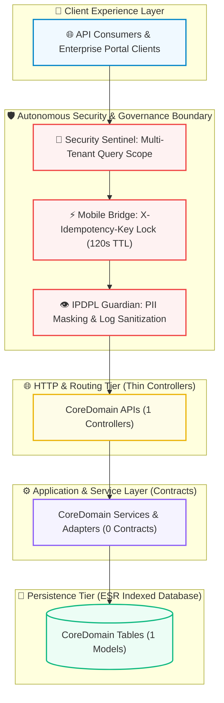
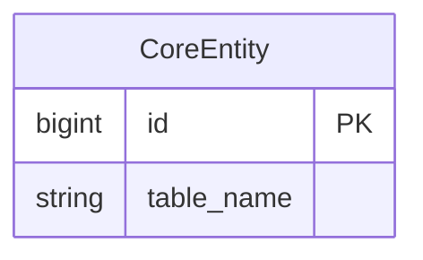

# Live System Topology & Reverse Architecture Specification

> **Engine:** `InnovaDigits Reverse Architecture Visualizer (v4.2.2)`  
> **Timestamp:** `2026-11-17T10:45:43.469Z`  
> **Codebase Metrics:** `0` Models • `0` Controllers/Groups • `0` Tables • `0` Contracts • `0` API Endpoints  
> **Architecture Pattern:** Microservice-Minded Modular Monolith (HMVC & Standalone Package Decoupling)

---

## 1. Live System Topology Diagram

Reconstructed dynamically from discovered `stack.json` profile flags, client entry points, API groups, service contracts, and database models:

---

## 2. Domain Entity Relationship Graph (Reconstructed ERD)

Reconstructed dynamically from discovered domain entities, EF Core `IEntityTypeConfiguration` definitions, and foreign key relationships:

---

## 3. Module Architecture & API Coverage Matrix

| Module / Bounded Context | Models | Controllers / Groups | UI Views | OpenAPI Endpoints | Postman Collection | Client SDK Status | Governance Health |
| :--- | :--- | :--- | :--- | :--- | :--- | :--- | :--- |
| **CoreDomain** | `1` | `1` | `0` | `0` | ⚪ PENDING | ➖ N/A (Disabled) | 🟢 GOVERNED |

---

## 4. Architectural Invariants & Decoupling Checklist

1. **Config-Bound BelongsTo Relations:** Cross-domain Eloquent relationships MUST resolve model classes dynamically via `config('module.models.key')` to ensure microservice extractability.
2. **Contract-Based Entity Resolution (`Contracts/External/`):** Cross-boundary data lookups use strictly-typed contracts (`findManyByIds`) avoiding SQL cross-joins.
3. **Dual-Guard Auth Identity Extraction:** Controllers extract user credentials safely via `AuthUserDto::fromRequest($request)` rather than concrete User model binding.
4. **Batch Transformer Hydration:** External entities are batch-resolved in service layers to guarantee zero N+1 database queries.
5. **Zero Cross-Boundary Foreign Keys:** Physical SQL foreign keys across package boundaries are strictly prohibited.

---
*Generated by InnovaDigits Reverse Architecture Visualizer Engine (v4.2.2).*
