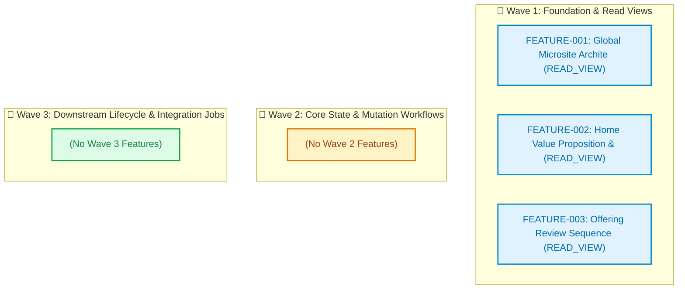

# Sprint Execution Plan & Dependency DAG (S1)

> **Sprint:** `S1` | **Layout:** `ba-hub-v2` | **Total Features:** `3` | **Generated:** `2026-11-17T10:47:01.988Z`  
> **Two-Gate Governance:** Gate A (`READY_FOR_DEV` BA Seal) ➔ Gate B (`READY_TO_CODE` via `ENG-01..ENG-10`).

---

## 1. Executive Two-Gate Readiness Summary

| Metric | Count | Ratio | Status |
| :--- | :--- | :--- | :--- |
| **Gate A (BA) Ready (`READY_FOR_DEV`)** | `3` | 100% | 🟢 BA SEALED |
| **Gate B (Eng) Ready (`READY_TO_CODE`)** | `3` | 100% | 🟢 ENG SEALED |
| **Already Implemented (`IMPLEMENTED`)** | `0` | 0% | 🔵 BASELINE |
| **Draft / Blocked (`BLOCKED` / `BLOCKED_BY_BA_GAP`)** | `0` | 0% | 🟢 ZERO BLOCKERS |
| **Total Features in Sprint Scope** | `3` | 100% | 📊 FULL REGISTRY |

---

## 2. Dependency Directed Acyclic Graph (Mermaid DAG)

---

## 3. Wave-by-Wave Execution Plan

### 🌊 Wave 1: Foundation & Master Entities (Parallel Track A)
- **Goal:** Establish lookup tables, `SEED-*` / `ENUM-*` catalogs, and `READ_VIEW` APIs without cross-table lock contention.
| Feature ID | Feature Name | Archetype | Gate A (BA) | Gate B (Eng) | Reused Entities | APIs Mapped |
| :--- | :--- | :--- | :--- | :--- | :--- | :--- |
| **FEATURE-001** | Global Microsite Architecture, Navigation & Design System | `READ_VIEW` | `READY_FOR_DEV` | `READY_TO_CODE` | Local | `0 routes` |
| **FEATURE-002** | Home Value Proposition & SEC-Verified Financial Metrics | `READ_VIEW` | `READY_FOR_DEV` | `READY_TO_CODE` | Local | `0 routes` |
| **FEATURE-003** | Offering Review Sequence & Pilot Deliverables Workflow | `READ_VIEW` | `READY_FOR_DEV` | `READY_TO_CODE` | Local | `0 routes` |

### 🌊 Wave 2: Core State & Mutations (Parallel Track B)
- **Goal:** Implement `MUTATION_WORKFLOW` state transitions, creation forms, and atomic `X-Idempotency-Key` locks.
| Feature ID | Feature Name | Archetype | Gate A (BA) | Gate B (Eng) | Reused Entities | APIs Mapped |
| :--- | :--- | :--- | :--- | :--- | :--- | :--- |
| - | None | - | - | - | - | - |

### 🌊 Wave 3: Downstream Lifecycle & Side-Effects (Parallel Track C)
- **Goal:** Complete approval gates, `INTEGRATION_JOB` workers, push/deep-link dispatch (`MB-12A/B`), and analytics exports.
| Feature ID | Feature Name | Archetype | Gate A (BA) | Gate B (Eng) | Reused Entities | APIs Mapped |
| :--- | :--- | :--- | :--- | :--- | :--- | :--- |
| - | None | - | - | - | - | - |

---

## 4. 5-Level WBS Lineage & Multi-Stack Task Decomposition (`CMP -> EPC -> FEATURE -> STR -> TSK`)

| Feature ID | Release | Lineage (`Component -> Epic -> Feature -> Story`) | Archetype | Department Task Worklist (`TSK-*`) |
| :--- | :--- | :--- | :--- | :--- |
| **FEATURE-001** | `REL-01` | `CMP-01 -> EPC-01 -> FEATURE-001 -> STR-001-01, STR-001-02` | `READ_VIEW` | `TSK-001-01-BE`, `TSK-001-01-WEB`, `TSK-001-01-MOB`, `TSK-001-01-QA`, `TSK-001-02-BE`, `TSK-001-02-WEB`, `TSK-001-02-MOB`, `TSK-001-02-QA` |
| **FEATURE-002** | `REL-01` | `CMP-02 -> EPC-02 -> FEATURE-002 -> STR-002-01, STR-002-02` | `READ_VIEW` | `TSK-002-01-BE`, `TSK-002-01-WEB`, `TSK-002-01-MOB`, `TSK-002-01-QA`, `TSK-002-02-BE`, `TSK-002-02-WEB`, `TSK-002-02-MOB`, `TSK-002-02-QA` |
| **FEATURE-003** | `REL-01` | `CMP-02 -> EPC-02 -> FEATURE-003 -> STR-003-01, STR-003-02` | `READ_VIEW` | `TSK-003-01-BE`, `TSK-003-01-WEB`, `TSK-003-01-MOB`, `TSK-003-01-QA`, `TSK-003-02-BE`, `TSK-003-02-WEB`, `TSK-003-02-MOB`, `TSK-003-02-QA` |

---

## 5. Table Concurrency & Collision Guard

| Table Name | Referencing Features | Concurrency Policy | Hazard Level |
| :--- | :--- | :--- | :--- |
| `system_tables` | Global Scope | Isolated Module Scoping | `LOW (ISOLATED)` |

---
*Automated Plan compiled by InnovaDigits Sprint DAG Engine (v4.0.0).*
